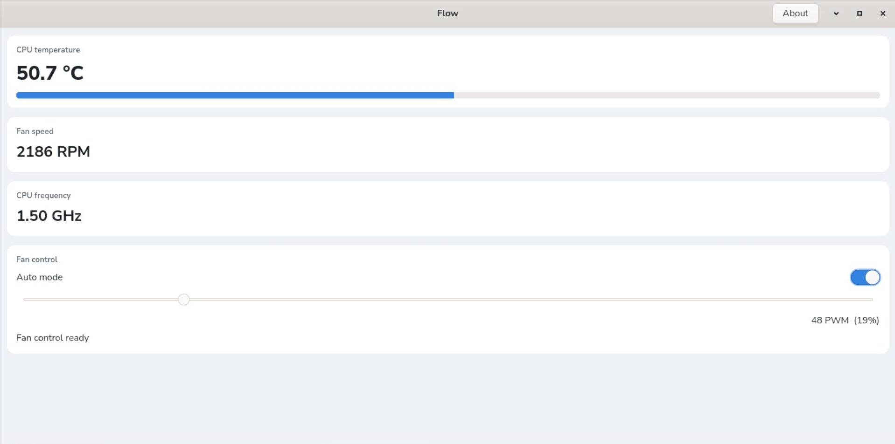

# Flow

<div align="center">

**A clean, lightweight GTK 4 fan and system monitor for Raspberry Pi 5**

[](https://www.raspberrypi.com/)
[](https://en.cppreference.com/w/c/17)
[](https://gtk.org/)

[Features](#-features) •
[Preview](#-preview) •
[Build](#-build-on-raspberry-pi-os) •
[Install](#-install) •
[Usage](#-usage)

</div>

---

## ✨ Features

- 🌡️ Live CPU temperature with a visual level bar
- 🌀 Fan speed monitoring
- ⚡ Current CPU frequency 
- 🤖 Automatic PWM cooling curve
- 🎚️ Manual fan PWM control from `0–255`
- 🔄 Sensor readings refreshed every two seconds
- 🚨 Clear status messages for PWM permission failures
- 🎨 Clean card-based GTK 4 interface
- 🖥️ Native Raspberry Pi desktop application

## 🖼️ Preview


<div align="center">
  
</div>

## 🔧 Requirements

- Raspberry Pi 5
- Raspberry Pi OS with desktop
- GTK 4
- CMake 3.16 or newer
- A C17-compatible compiler

Install the development packages:

```bash
sudo apt update
sudo apt install build-essential cmake pkg-config libgtk-4-dev
```

## 🛠️ Build on Raspberry Pi OS

Clone the repository:

```bash
git clone https://github.com/Gavinduachintha/Flow.git
cd Flow
```

Configure and build:

```bash
cmake -S . -B build
cmake --build build -j$(nproc)
```

Run the application directly:

```bash
./build/flow
```

## 📦 Install

Install `flow` system-wide:

```bash
cmake -S . -B build-release \
  -DCMAKE_BUILD_TYPE=Release \
  -DCMAKE_INSTALL_PREFIX=/usr

cmake --build build-release -j$(nproc)
sudo cmake --install build-release
```

Start it from the terminal:

```bash
flow
```

Or create a desktop launcher in `~/.local/share/applications/flow.desktop`:

```ini
[Desktop Entry]
Type=Application
Name=Flow
Comment=Raspberry Pi fan and system monitor
Exec=flow
Icon=flow
Terminal=false
Categories=System;Utility;
StartupNotify=true
```

Refresh the desktop application database:

```bash
update-desktop-database ~/.local/share/applications
```

## 🎛️ Usage

- **Auto mode enabled:** Flow calculates PWM from the CPU temperature.
- **Below 45 °C:** PWM is set to `0`.
- **45–75 °C:** PWM rises linearly from `0` to `255`.
- **At or above 75 °C:** PWM is set to `255`.
- **Manual mode:** Move the PWM slider to write a value between `0` and `255`.

> [!IMPORTANT]
> Manual fan control and automatic PWM writes require permission to access
> `/sys/class/hwmon/hwmon2/pwm1`. Flow should be run as a normal desktop user,
> not with `sudo`.

### Configure fan permissions

The project includes `99-flow-pwmfan.rules`. Install it and add your user to
the `gpio` group:

```bash
sudo cmake --install build
sudo usermod -aG gpio "$USER"
sudo udevadm control --reload-rules
sudo udevadm trigger --subsystem-match=hwmon
sudo reboot
```

After rebooting, verify the permissions:

```bash
ls -l /sys/class/hwmon/hwmon2/pwm1
groups
```

The PWM file should be writable by the `gpio` group. If Flow still reports a
fan write failure, confirm that the detected hwmon name is `pwmfan`:

```bash
cat /sys/class/hwmon/hwmon2/name
```

## 📁 Project Structure

```text
Flow/
├── include/
│   ├── ui/window.h
│   ├── config.h
│   ├── controller.h
│   ├── fan.h
│   ├── system_info.h
│   └── thermal.h
├── src/
│   ├── ui/window.c
│   ├── main.c
│   ├── config.c
│   ├── controller.c
│   ├── fan.c
│   ├── system_info.c
│   └── thermal.c
├── CMakeLists.txt
└── README.md
```

## 👨‍💻 Developer

Created by **Gavinduachintha**

- GitHub profile: [github.com/Gavinduachintha](https://github.com/Gavinduachintha)
- Project repository: [github.com/Gavinduachintha/Flow](https://github.com/Gavinduachintha/Flow)

---

<div align="center">
Built with C17, GTK 4, and Raspberry Pi 5 hardware in mind.
</div>
